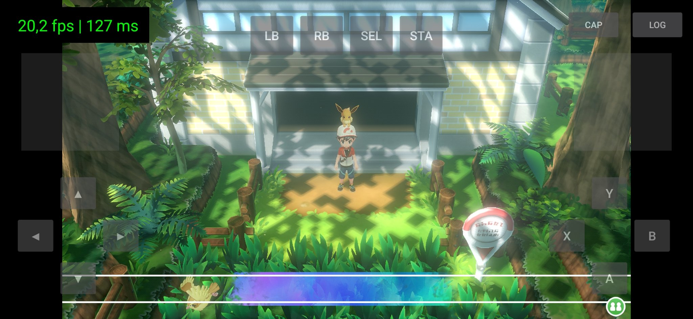
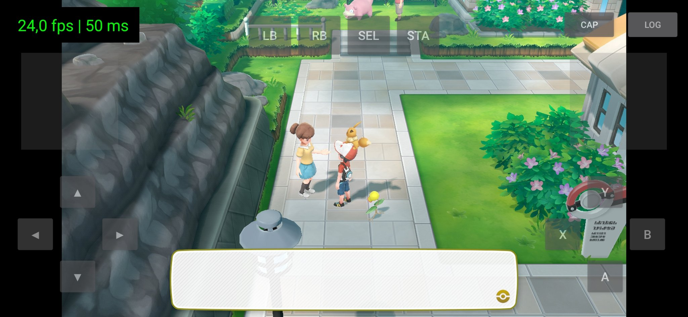
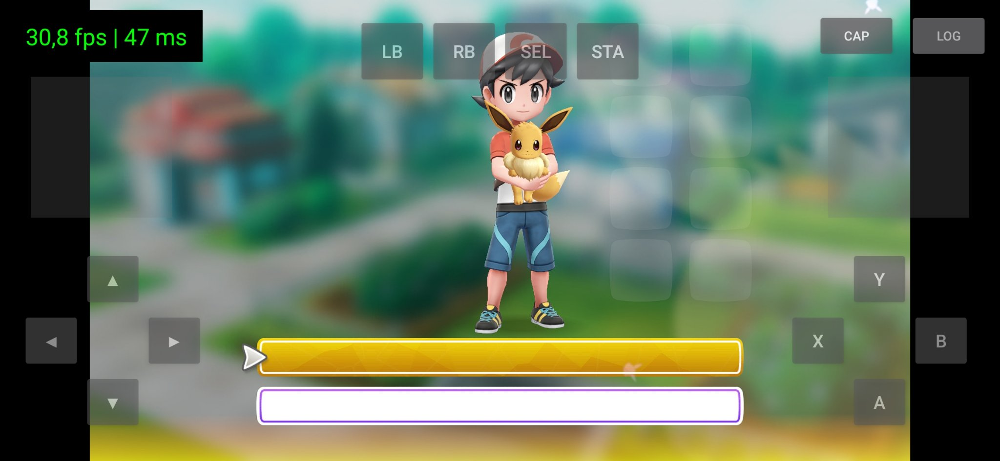
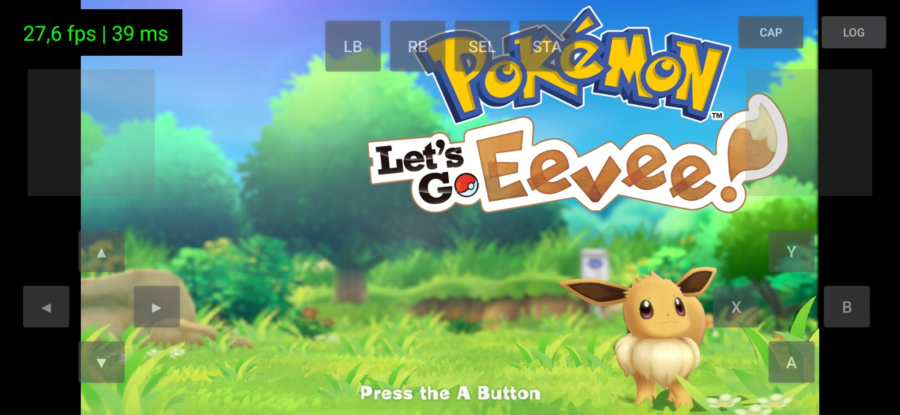
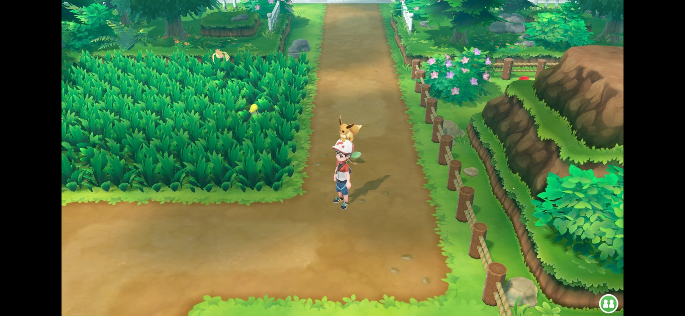
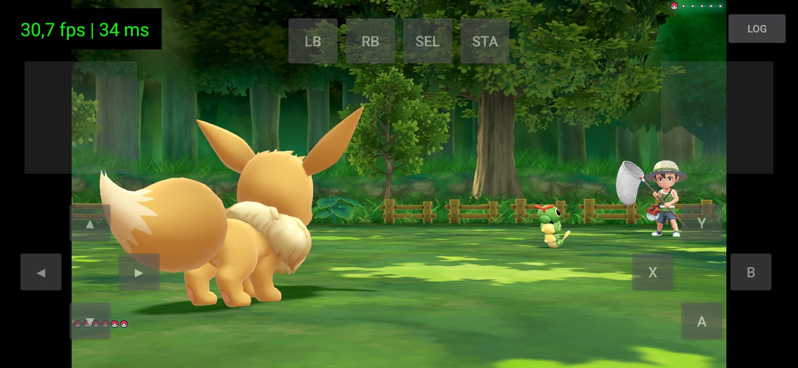
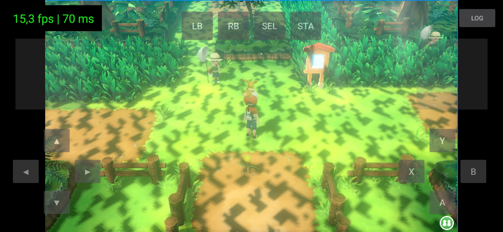
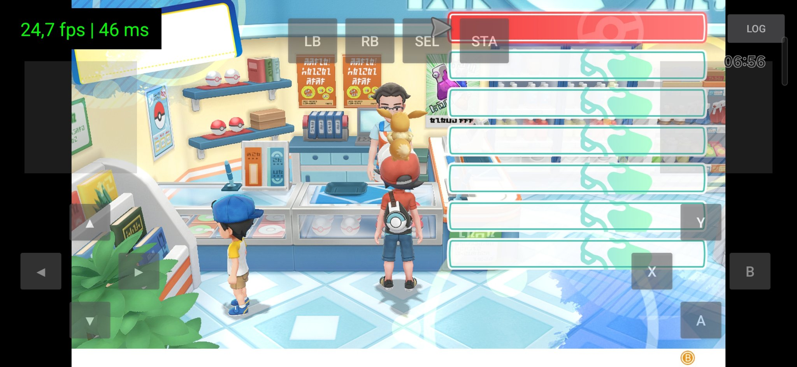
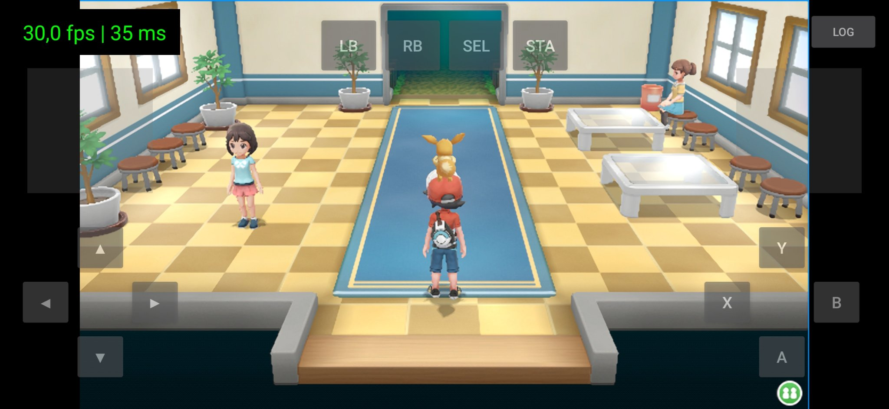

# Let's Go Eevee — Port Android

Port não-oficial de **Pokémon Let's Go, Eevee!** (Nintendo Switch) para Android, baseado no
[letsgo-recomp](https://github.com/raulzrrs/letsgo-recomp) (recompilação estática, por raulzrrs).
Testado no Galaxy S23 (Snapdragon 8 Gen 2, Adreno 740, Android 16).

> **Uso pessoal. Este repositório NÃO contém o jogo, nem código do jogo, nem chaves.**
> Para buildar você precisa do seu próprio dump legalmente obtido (ver [BUILD.md](BUILD.md)).
>
> 📺 Canal da autora no YouTube: https://youtube.com/@emuucheck

## O que este repositório contém

| Pasta/arquivo | Conteúdo |
|---|---|
| `src/` | Código-fonte completo: `runtime/` (NVN→Vulkan, HLE, SDL3), `tools/` (geração: `gen.py`, `lifter.py` e mais 22 scripts), `Makefile`, `third_party/` (imgui, smaa, vma, fontes), `docs/` (docs upstream) |
| `apk/` | App Android: launcher, importador in-app, overlay de controles, manifest |
| `importer/` | Importador de NSP no aparelho (lê o dump do usuário e extrai `exefs`/`romfs`) |
| scripts na raiz | Scripts de build (`build-runtime.sh`, `link-runtime.sh`, `build-apk.sh`, etc.) |
| `docs/` | Documentação do projeto: auditorias, relatórios de builds, HOWTO original |
| `screenshots/` | Capturas do jogo rodando no S23 (estado atual) |
| `BUILD.md` | **Tutorial completo de build**: o que você precisa, passo a passo |
| `ISSUES.md` | **Problemas conhecidos**: o que funciona, o que não funciona, e o que já foi investigado |
| `RELATORIO-ATUALIZADO.md` | Relatório detalhado do estado do projeto (v0090) |

## O que este repositório NÃO contém (de propósito)

- ❌ O código recompilado do jogo (`generated-aarch64/`) — derivado do binário da Nintendo
- ❌ O NSP, `prod.keys`, `title.keys` ou qualquer dump — use o seu próprio
- ❌ Assets do jogo (texturas, modelos, fontes, áudio)
- ❌ APKs prontos — eles embutem o jogo recompilado e não podem ser distribuídos

Sem o código gerado e o dump, o projeto **não compila sozinho**. O [BUILD.md](BUILD.md)
explica como gerar tudo a partir do seu próprio dump.

## Estado atual (v0090)

**Funciona:** boot, mundo 3D, mapa, batalhas, menus, save, touch e controle físico,
importador de NSP, resolução escalável (480p–1080p), ~22–30 fps.

**Não funciona:** **o texto é invisível** em menus, diálogos e HUD. É o problema principal
e está documentado em detalhes em [ISSUES.md](ISSUES.md) — incluindo tudo o que já foi
eliminado por prova (cull, depth, write_mask, scissor, matriz de projeção, atributo `a0`,
janela de cópia de memória) e o teste decisivo atual (v0090, VS_RANGE_DIAG).

### Screenshots — estado atual (Galaxy S23, v0090)

O mundo 3D, as batalhas e os menus renderizam — mas **todo texto dinâmico está vazio**.
As caixas de diálogo, menus e listas de itens abrem em branco. (As imagens abaixo são
capturas do jogo rodando no aparelho, apenas para demonstrar o estado do port.)

| | |
|---|---|
|  |  |
| Mundo renderizando (20 fps) com caixa de diálogo aberta | Caixa de diálogo **vazia** — o texto não aparece |
|  |  |
| Menu do jogo com barras **vazias** (sem texto) | Tela-título funciona (texto da logo é textura, não texto dinâmico) |
|  |  |
| Viridian Forest: caminho e vegetação renderizando | Batalha funcionando (30 fps) |
|  |  |
| Sombras blocadas na floresta (15 fps — ver ISSUES.md §4) | Loja: prateleiras e lista de itens com textos **vazios** |
|  | |
| Interior do Centro Pokémon renderizando (30 fps) | |

## Build rápido

```bash
# 1. Gere o código do jogo a partir do SEU dump (ver BUILD.md)
cd src && make gen ARCH=aarch64

# 2. Compile o runtime, o importador e linke
./build-runtime.sh    # espera SMOKE_OK
./build-importer.sh
./link-runtime.sh     # espera RUNTIME_LINK_OK

# 3. Monte e assine o APK
./build-apk.sh        # APK sai na raiz
```

Detalhes, pré-requisitos e armadilhas: **[BUILD.md](BUILD.md)**.

## Créditos

- [raulzrrs / letsgo-recomp](https://github.com/raulzrrs/letsgo-recomp) — recompilação estática original
- [peiikai / LASRecomp](https://github.com/peiikai/LASRecomp) — base do runtime (ver `LICENSE-LASRecomp`)
- [Nycolazs / LASRecomp-Android-Plus](https://github.com/Nycolazs/LASRecomp-Android-Plus) — referência de port Android
