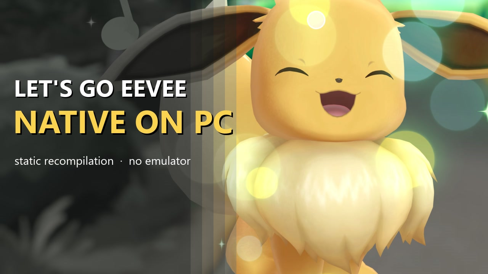
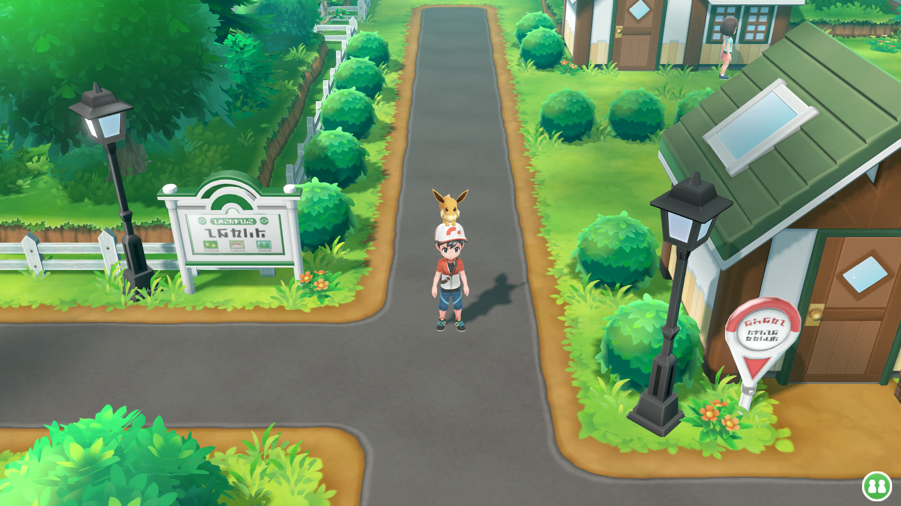
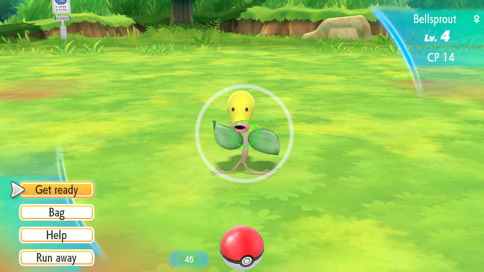
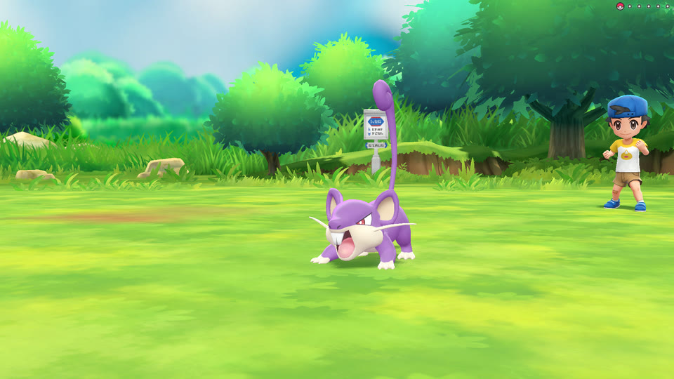
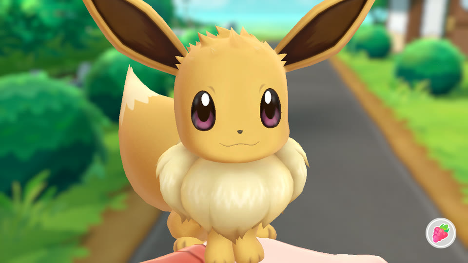
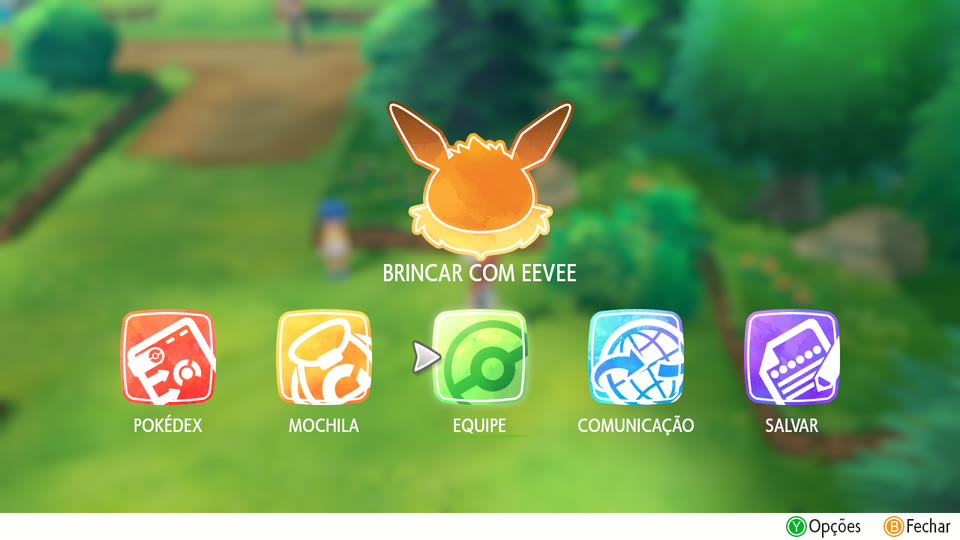
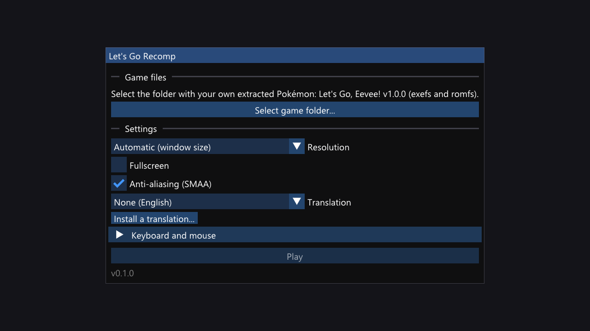

# Let's Go Recomp

A native Windows port of **Pokémon: Let's Go, Eevee!** and **Let's Go, Pikachu!** (Nintendo Switch) made by **static recompilation**.
The game's ARM64 code is translated into C and compiled into a regular Windows program; a runtime stands in for the
Switch's operating system (kernel, system services, NVN graphics on Vulkan, audio, controllers, touch screen).
**It is not an emulator.**

This project is built on the runtime and recompiler of **[LAS Recomp](https://github.com/peiikai/LASRecomp)** by
Peiikai, the static recompilation of *The Legend of Zelda: Link's Awakening*, adapted here to a different game
engine.

**Highlights:** up to **4K** internal resolution (supersampled on smaller screens) · **SMAA** anti-aliasing (the
original has none) · **16x anisotropic filtering** · the game's own **30 fps**, locked and stable, or an experimental **60 fps** overworld · experimental **wild battles** ·
keyboard, mouse and any controller · fan translations in one click.

> [!IMPORTANT]
> **No game files are included.** You need your own legally obtained copy of *Pokémon: Let's Go, Eevee!* or
> *Pikachu!*, extracted (the `exefs` and `romfs` folders). This repository does not provide the game, its
> keys, or instructions on how to obtain them. Nothing from the game (code, graphics, text, music, fonts) is part of
> this repository or of its releases.

*Português: [veja a seção em português](#português) no fim, com o passo a passo da tradução PT-BR.*

[](https://youtu.be/mGk-wBu1wCk)

*▶ [Showcase video](https://youtu.be/mGk-wBu1wCk) (6 min): launcher, Play with Eevee, a capture, a rival battle, menus.*



<table>
<tr>
<td><br>Catching a wild Pokémon (aimed with the mouse or a stick)</td>
<td><br>Trainer battle on Route 1</td>
</tr>
<tr>
<td><br>Play with Eevee (the touch screen, with mouse or controller)</td>
<td><br>With the Brazilian Portuguese fan translation</td>
</tr>
</table>

*Screenshots of this port running on Windows (game rendered at 1280x720, captured straight from the renderer).*

## Contents
- [Status](#status)
- [Requirements](#requirements)
- [Supported game version](#supported-game-version)
- [How to play](#how-to-play)
- [Features](#features)
- [Controls](#controls)
- [Translations and mods](#translations-and-mods)
- [What was tested](#what-was-tested)
- [Known issues and limitations](#known-issues-and-limitations)
- [How it works](#how-it-works)
- [Building from source](#building-from-source)
- [FAQ](#faq)
- [Documentation](#documentation)
- [Credits](#credits)
- [Legal](#legal)
- [License](#license)
- [Português](#português)

## Status

**Playable.** The opening movie, the introduction, exploring, wild captures, trainer battles, menus, the Pokédex,
Play with your partner, and saving and loading all work, at a **stable 30 fps** (the game's own frame rate) at any
resolution from 720p to 4K, on **Windows**. Most of the testing was with **Eevee v1.0.0**; **Pikachu** is accepted since
0.2.1 (see [Supported game version](#supported-game-version)). It has not been played from start to finish yet: see [What was tested](#what-was-tested).

## Requirements

| | Minimum |
|---|---|
| OS | Windows 10 or 11, 64-bit |
| CPU | x86-64 with **AVX2, FMA and BMI2** (Intel Haswell / 2013 or newer, AMD Excavator / Zen or newer). Checked at startup, with a message instead of a crash |
| GPU | a driver with **Vulkan 1.3**: GPUs that report less are skipped. AMD lists Vulkan 1.3 for Radeon RX Vega and RDNA cards; for any GPU, [gpuinfo.org](https://vulkan.gpuinfo.org) shows the version its driver reports |
| RAM | the game used up to **3.8 GB** while playing (peak working set, measured in Viridian City). The one-time setup peaked at **5.2 GB** (one compiler per CPU thread, fewer when RAM is short). Tested only on a 32 GB machine |
| Disk | about **6 GB** free: 5.7 GB at the peak of the one-time setup, 4.6 GB afterwards (measured) |
| Game | your own extracted *Pokémon: Let's Go, Eevee!* or *Pikachu!*: see [Supported game version](#supported-game-version) |

Only tested so far on Windows 11 with an Intel Core i5-14600KF, 32 GB of RAM and an NVIDIA GeForce RTX 3080. Reports
from other CPUs and GPUs (AMD, Intel) are very welcome.

## Supported game version

The game code is recompiled from your own executable during the setup, so either game and any version of it is
accepted. What was tested:

| | Supported | Not supported |
|---|---|---|
| Game | *Pokémon: Let's Go, Eevee!* (title id `0100187003A36000`) and, since 0.2.1, *Let's Go, Pikachu!* (`010003F003A34000`). Pikachu 1.0.0 was tested here from the setup to the name screen of a new game; a player reported Pikachu 1.0.2 playable up to receiving Pikachu ([issue #1](https://github.com/raulzrrs/letsgo-recomp/issues/1)) | |
| Version | **1.0.0**, the base game, of either: the only builds with the experimental **60 fps** and **wild battles** options, which work on addresses of the game's executable (mapped for both, `tools/addrmap.py`); the launcher greys them out for any other | the 1.0.1 (January 2019) and 1.0.2 (July 2019) updates are accepted, without those options, but untested here |
| Files | the extracted **`exefs`** folder (`main`, `main.npdm`, `rtld`, `sdk`, `subsdk0`, `subsdk1`) and the **`romfs`** folder, or a `romfs.bin` image (both tested) | `.xci`, `.nsp`, `.nsz`, `.xcz` or `.nca` files: extract them first |
| Region | the same title id is listed in the US, UK, Brazil, Japan, Korea and Hong Kong / Taiwan eShops, with the same two updates for all of them ([titledb](https://github.com/blawar/titledb)). Switch updates are patches over the base game, so every region's 1.0.0 is the same. Tested with one dump, from a cartridge | |
| Game language | the 9 languages of the game's own language screen, shown when starting a new game: English, Español, Français, Deutsch, Italiano, Japanese, Korean, Simplified and Traditional Chinese (tested). The game warns the choice can't be changed later, and an existing save keeps its language | |
| Fan translations | Atmosphere / LayeredFS `romfs` packs, such as the Brazilian Portuguese one ([Translations](#translations-and-mods)) | patches that change the executable (`exefs` / IPS patches) |
| Save data | saves created by this port (`save\save_0\savedata.bin`) | importing a Switch save: untested |
| Extras | the communication screens open without crashing (local trade searches and B goes back; Mystery Gift waits on "Connecting...", which the game gives no way out of offline) | the Poké Ball Plus, Pokémon GO / GO Park transfers, local and online play, Mystery Gift, the second player |

The launcher reads the program id in your `exefs/main.npdm` and refuses anything other than the two games, saying
why. The 60 fps and wild battles options need the 1.0.0 `main` of either game (build id starting with `0A3F0D21E67DAD80`
for Eevee, `1C375692DE4F4B87` for Pikachu).

## How to play

1. Download the latest `LetsGoRecomp-<version>-windows.zip` from the [Releases](../../releases) page.
2. Unzip it into a folder you can write to (for example `D:\Games\LetsGoRecomp`; not inside `Program Files`).
3. Open **`LetsGoRecomp.exe`**. The exe is not code-signed, so the first time Windows may show *"Windows protected
   your PC"*: click **More info**, then **Run anyway**.
4. Click **Select game folder...** and choose the folder with your extracted game: the one holding `exefs` and
   `romfs` (a `romfs.bin` image works too), or any folder above it.
5. The launcher checks the files are *Let's Go, Eevee!* or *Pikachu!*, copies them and **recompiles the game code for your
   PC**. This happens only once and takes a while: 13 minutes (measured) on a 20-thread Core i5-14600KF, longer on
   CPUs with fewer threads. A progress bar shows how far it got.
6. Click **Play**.



**Both games:** a folder holds one set-up game (its `extracted\` folder), so to have *Eevee* and *Pikachu* side by side
unzip the release twice (for example `LetsGoRecomp-Eevee` and `LetsGoRecomp-Pikachu`) and set each one up with its game.
**Change...** on the start screen swaps the game in that folder instead (setting it up again).

Settings (`larecomp.ini`), saves (`save\`; `save-pikachu\` for Pikachu), the game files (`extracted\`), translations (`mods\`), shader caches
(`cache\`) and the log (`lasrecomp.log`) are all kept in that folder: to back up or move the game, copy the folder.

## Features

- **Native code:** the game's code runs compiled for your CPU, not interpreted or emulated.
- **Image quality:**
  - internal resolution from 720p to 4K, including above your screen's (supersampling, scaled down with a
    high-quality filter);
  - SMAA anti-aliasing (the game has none) and 16x anisotropic filtering;
  - any window size or aspect ratio, and fullscreen.
- **No shader stutter:** the game's GPU shaders are translated in parallel and cached on disk (SPIR-V and Vulkan
  pipeline caches), and objects wait for their shader instead of popping in.
- **Simple launcher:** pick the game folder once, then resolution, fullscreen, anti-aliasing, translation and key
  bindings. In English, or in Brazilian Portuguese when Windows is.
- **Keyboard and mouse:** all keys can be rebound in the launcher. The mouse aims Poké Balls like the Switch's motion
  controls and acts as your finger on the touch screen.
- **Controllers:** through SDL 3's gamepad support, with the handheld-mode layout (tested with one gamepad so far). Play with your partner works with a controller alone (the right stick moves a virtual finger).
- **Translations and mods:** Atmosphere-style LayeredFS mods, installed from the downloaded file with one click.
- **Experimental options** (start screen, off by default):
  - **60 fps:** the overworld at 60 fps natively (the game's time step is halved there, so nothing speeds up); menus
    and the Pokédex shown at 60 with an in-between frame; battles and captures stay at 30 fps;
  - **Wild battles:** touching a wild Pokémon starts a classic battle against it (species, level, gender, IVs,
    level-up moves), then the capture. Details in [docs/MODO-BATALHA.md](docs/MODO-BATALHA.md) (Portuguese).

## Controls

The game runs in handheld mode (one player).

| Action | Keyboard (default) | Mouse | Controller |
|---|---|---|---|
| Walk / aim | WASD | | left stick |
| A: confirm, talk, throw | Space or Enter | left button (while aiming) | A |
| B: back | Q or Backspace | right button | B |
| X: menu | Tab | | X |
| Y: options, box | R | | Y |
| L / R | Z / C | | L / R |
| + partner / − Pokédex | `=` / `-` | | + / − |
| D-pad | arrow keys | | D-pad |
| Aim a Poké Ball | WASD | move (after "Get ready") | left stick |
| Touch screen (Play with your partner) | | hold the left button | right stick + hold ZR |
| Close the game | Esc | | − and + together |

While you aim a Poké Ball the mouse is captured by the window; outside of aiming it is free. Mouse sensitivity is
set in the launcher.

## Translations and mods

The game has no Portuguese (or any other fan) translation of its own; fan translations are distributed as
Atmosphere LayeredFS packs, and those work as they are:

1. Click **Install a translation...** in the launcher.
2. Pick the file you downloaded (`.zip`, `.rar` or `.7z`, as it came), and the launcher unpacks it and finds the
   `romfs` folder for the game you set up (by its title id) inside it. Packs made for both games are fine.
3. Choose it under **Translation**. "None (English)" goes back to the original game.
4. A translation replaces the texts of one or more of the game's languages, so the game has to be in one of them.
   The Brazilian Portuguese pack replaces English and Spanish: pick English or Español on the game's language screen
   when starting a new game, or use a save made in one of those.

Installed mods live in `mods\<name>\romfs\`; you can also copy a `romfs` folder there by hand. Files in it replace
the game's files with the same path, and new files are added.

Tested with the Brazilian Portuguese fan translation by **Pokémon Switch Brasil** (see [Português](#português)).
It is not included in this repository or in the releases; it is distributed by its authors.

## What was tested

Tested by playing on Windows 11, RTX 3080, 1920x1080 monitor, with keyboard and mouse and with a controller, plus
scripted input runs (recorded inputs replayed frame by frame, see [docs/DEPURACAO.md](docs/DEPURACAO.md)). Everything
below is *Eevee* 1.0.0 unless the row says otherwise:

| Area | Result |
|---|---|
| Boot, opening movie (video and audio) | ✅ works, 1080p video, ends and goes to the title screen |
| New game: language, Professor Oak, character choice, name entry | ✅ |
| Your room, Pallet Town, Route 1, Viridian City (3D, characters, Pokémon) | ✅ correct, including skinned models |
| Wild Pokémon capture (aiming with stick, mouse and the virtual motion sensor) | ✅ |
| Trainer battle (Route 1) | ✅ |
| Menus, bag, Pokédex, party, box, Pokémon icons | ✅ |
| Play with Eevee | ✅ petting with the mouse; the whole berry flow (open the tray, pick a Razz Berry, feed it) with a controller only |
| Save and load | ✅ (`save\save_0\savedata.bin`) |
| Music and sound effects | ✅ no crackling or underruns in a 4-minute measured run |
| Release zip on a clean folder, without any development tools on PATH: game setup, recompiling, playing, installing the translation from the downloaded `.rar` | ✅ |
| Frame rate | ✅ stable 30 fps (minimum 28.6 over 2 s windows, 4 minutes on Route 1) |
| Resolutions 720p, 1080p, 1440p, 4K; windowed, resized, fullscreen | ✅ (4K renders at ~78 fps uncapped on an RTX 3080) |
| PT-BR fan translation (texts, menus, translated images) | ✅ |
| Keyboard rebinding; playing with a controller | ✅ |
| 60 fps (experimental): world, menus and Pokédex at 60 without speed-ups; battles and captures at normal speed | ✅ played |
| Wild battles (experimental): battle, then capture, back to the world (Route 1) | ✅ played |
| *Pikachu* 1.0.0: setup, new game up to the name screen, the world, menus, 60 fps, wild battles and captures (from a copy of an Eevee save), the PT-BR translation, the Pokémon GO settings screen | ✅ played |
| *Pikachu* 1.0.2 (another player, [issue #1](https://github.com/raulzrrs/letsgo-recomp/issues/1)): AMD RX 7800 XT, Windows 10, up to receiving Pikachu | ✅ reported |

**Not tested yet:** a whole *Pikachu* playthrough (its own new game past the name screen, Play with Pikachu, its
exclusive Pokémon), the 1.0.1 / 1.0.2 updates here, the rest of the story past Viridian City (gyms, other cities and caves, the Elite Four), every
move animation and every Pokémon, AMD and Intel GPUs, laptops, other Windows versions, Steam Deck / Linux.

## Known issues and limitations

- **Tested mostly with *Let's Go, Eevee!* v1.0.0.** *Let's Go, Pikachu!* and the updates are accepted but much less
  tested; the experimental 60 fps and wild battles options need the 1.0.0 (base game) of either.
- **Windows only.** The Linux code path comes from LAS Recomp and builds in principle, but has never been tested
  with this game.
- **60 fps is experimental and partial.** The game advances most of its logic one step per frame: only the
  overworld follows the game's time step, so only it runs at 60 fps natively; battles and captures stay at 30.
  The research is in [docs/PESQUISA-60FPS.md](docs/PESQUISA-60FPS.md) (Portuguese).
- **Wild battles are experimental:** experience is not split between the battle and the capture yet, and the
  touched Pokémon's nature, shiny state and regional form are not carried over.
- **Auras:** the colored aura of special wild Pokémon sometimes disappears for a single frame.
- **First visit to an area:** the first time a new object appears on your PC it can show up a frame or two late
  while its shader is prepared. From then on the cache on disk covers it.
- **Motion controls:** the gyro of controllers that have one (DualSense, Pro Controller) is not used yet; aim with
  the stick or the mouse.
- **Online features are off:** Pokémon GO / GO Park transfers, trades, online battles, the Poké Ball Plus and
  local wireless play.
- **No co-op:** the second player (shared play) is not supported.
- **System font:** a few texts use the Switch's built-in font, which is not part of the game files; Windows'
  Yu Gothic stands in for it. A copy dumped from your own console can be placed in `fonts\`
  ([fonts/README.md](fonts/README.md)).
- Long sessions have been stable in testing, but the game has not been played to the end: please report crashes
  with the `lasrecomp.log` file (see [CONTRIBUTING.md](CONTRIBUTING.md)).

## How it works

The Switch runs ARM64 code; a PC runs x86-64. Instead of emulating the Switch's CPU, the game's code is translated
ahead of time:

1. **Recompiler** (`tools/gen.py`, from LAS Recomp): reads the game's four executable modules (`main`, `sdk`,
   `subsdk0`, `subsdk1`), finds every function, and turns each ARM64 instruction into equivalent C code (with AVX2
   for the NEON / floating-point instructions). The result is about 920 C files.
2. **Compiler:** that C code is compiled into `lasgame.dll`, the game code library. In the release this happens on
   your PC, from your own files, with a bundled compiler ([Zig](https://ziglang.org) / clang); no game code is ever
   distributed.
3. **Runtime** (`LetsGoRecomp.exe`): loads the game code and provides everything the game expects from the Switch:
   - a kernel (threads, synchronization, memory) and the system services (file system, settings, time, audio,
     controllers, touch screen, video decoding, offline stubs for network services);
   - the **NVN** graphics API implemented on **Vulkan**, with the Switch GPU's (Maxwell) shaders translated to
     SPIR-V at run time;
   - high-level replacements (HLE) for a few SDK functions, such as the movie player and the software keyboard.

The original game files stay untouched; translations are applied as file replacements when the game reads them
(LayeredFS). The full story of the port, with every problem found and how it was solved, is in
[docs/HISTORICO.md](docs/HISTORICO.md) (Portuguese).

## Building from source

You only need this to work on the project; to play, use the [release](#how-to-play).

Requirements: Windows 10/11 x64, [MSYS2](https://www.msys2.org) (UCRT64: clang, make, SDL3, FFmpeg, shaderc,
Vulkan headers), Python 3.12 with `capstone`, `unicorn` and `lz4`. `tools/setup_windows.ps1` installs all of it.

```bash
export PATH="/c/msys64/ucrt64/bin:/c/msys64/usr/bin:$PATH"   # Git Bash, or use the MSYS2 UCRT64 shell
make -j20 build/lasrecomp.exe   # the runtime
./build/lasrecomp.exe           # the launcher: select your game folder, it builds the game code (.venv + clang)
```

Or by hand, with your files in `extracted/` (`exefs/` and `romfs.bin`):

```bash
make gen                        # translate the game code into generated/
make -j20 build/lasgame.dll     # compile it (always with -j: ~920 files)
./build/lasrecomp.exe extracted --play
```

The release zip: `make deps-windows` (an LGPL-only FFmpeg with just the decoders the game needs), `make gen-helper`
(the generator frozen with PyInstaller), `tools/fetch_zig.sh` (the pinned Zig compiler), then `make dist`.

Step by step, from a clean PC: [docs/COMPILAR-WINDOWS.md](docs/COMPILAR-WINDOWS.md) (Portuguese; the commands are
the same). Debugging tools and environment variables: [docs/DEPURACAO.md](docs/DEPURACAO.md).

## FAQ

**Is this an emulator?** No. There is no CPU emulation: the game's code was converted to native x86-64 code. The
runtime implements the Switch's system services, a bit like Wine does for Windows programs.

**Why does it compile the game on my PC?** The game code generated from the game's files is still Nintendo's code,
so it cannot be distributed. The release ships the tools instead, and builds it from your own copy.

**Can I use my save from the Switch?** Not tested. The port keeps the file the game itself writes, at
`save\save_0\savedata.bin`, but importing one from a console has never been tried.

**Does it work with Let's Go, Pikachu!?** Since 0.2.1, yes, with its own save folder (`save-pikachu\`). Tested
here with 1.0.0 up to the name screen of a new game; a player played 1.0.2 up to receiving Pikachu (issue #1). The
experimental 60 fps and wild battles options work with Pikachu 1.0.0 too.

**Can I use an updated game (v1.0.1 / v1.0.2)?** It is accepted since 0.2.1, but not tested here, and the
experimental options stay off for it (they need the 1.0.0 of either game).

**The launcher says the files are packed (.xci / .nsp).** Extract the game's `exefs` and `romfs` first, with your
usual tool, from your own dump.

**Windows Defender or my antivirus flagged a file.** The bundled game code generator (`lasgen\lasgen.exe`) is a
Python program packaged with PyInstaller, a format antivirus heuristics sometimes flag by mistake. Everything in the
release is built from this repository's source by `make dist`. If a file was quarantined, the launcher reports the
builder as missing: restore it or add the folder as an exception, then select the game folder again.

**Where is the log?** `lasrecomp.log`, next to the exe.

## Documentation

Most internal documentation is in Portuguese.
- [docs/COMPILAR-WINDOWS.md](docs/COMPILAR-WINDOWS.md): building from source, step by step
- [docs/PROGRESSO.md](docs/PROGRESSO.md): what works and what is missing
- [docs/ROADMAP.md](docs/ROADMAP.md): prioritized work and release criteria for a mature port
- [docs/HISTORICO.md](docs/HISTORICO.md): every problem found, its cause and fix
- [docs/DEPURACAO.md](docs/DEPURACAO.md): debugging tools and environment variables
- [docs/DIAGNOSTICO.md](docs/DIAGNOSTICO.md): the game's modules and translator coverage
- [docs/MODO-BATALHA.md](docs/MODO-BATALHA.md): experimental classic battles against wild Pokémon (in progress)
- [docs/PESQUISA-60FPS.md](docs/PESQUISA-60FPS.md): research on 60 fps
- [CONTRIBUTING.md](CONTRIBUTING.md): how to report problems and contribute
- [CHANGELOG.md](CHANGELOG.md): what changed in each release

## Credits

- **[LAS Recomp](https://github.com/peiikai/LASRecomp)** by **Peiikai**: the static recompiler and the runtime this
  project is built on (MIT, [LICENSE-LASRecomp](LICENSE-LASRecomp)). Without it this port would not exist.
- **Pokémon Switch Brasil** (Derek and team): the Brazilian Portuguese fan translation used to test translation
  support. Not included; distributed by the group.
- **Libraries and tools:**
  - [SDL 3](https://libsdl.org) (zlib): window, input, audio;
  - [FFmpeg](https://ffmpeg.org) (LGPL 2.1, dynamically linked): the game's movies and Opus audio;
  - [Dear ImGui](https://github.com/ocornut/imgui) (MIT): launcher and in-game dialogs;
  - [Vulkan Memory Allocator](https://github.com/GPUOpen-LibrariesAndSDKs/VulkanMemoryAllocator) (MIT);
  - [shaderc](https://github.com/google/shaderc) (Apache 2.0): GLSL to SPIR-V;
  - [SMAA](https://github.com/iryoku/smaa) (MIT, `third_party/smaa/LICENSE.txt`);
  - [AMD FidelityFX FSR 1](https://github.com/GPUOpen-Effects/FidelityFX-FSR) (MIT): upscaling;
  - the [Baloo 2](https://github.com/EkType/Baloo2) font (SIL OFL 1.1, `third_party/fonts/Baloo2/OFL.txt`);
  - [Capstone](https://www.capstone-engine.org), [Unicorn](https://www.unicorn-engine.org) and
    [python-lz4](https://github.com/python-lz4/python-lz4) in the recompiler; [PyInstaller](https://pyinstaller.org)
    and [Zig](https://ziglang.org) (MIT) in the release.
- The Switch homebrew community's documentation ([Switchbrew](https://switchbrew.org)) and
  [envytools](https://github.com/envytools/envytools) (NVIDIA GPUs).

## Legal

This is a fan project with no affiliation with, endorsement or sponsorship by Nintendo, The Pokémon Company, Game
Freak or Creatures. *Pokémon*, *Pokémon: Let's Go, Eevee!* and *Pokémon: Let's Go, Pikachu!* are trademarks of their respective owners. No game
files, code, graphics, text, music or fonts are included. To play, you must provide your own legally obtained copy.

## License

The code in this repository (the recompiler, the runtime and the tools) is under the [MIT license](LICENSE), like
LAS Recomp it is built on. Third-party components keep their own licenses (see [Credits](#credits)). The license
covers this code only and grants no rights to the game.

---

## Português

**Let's Go Recomp** é um port nativo para Windows do *Pokémon: Let's Go, Eevee!* e do *Pikachu!* (Switch) feito por
recompilação estática, baseado no [LAS Recomp](https://github.com/peiikai/LASRecomp). **Nenhum arquivo do jogo vem
junto:** você precisa da sua própria cópia, obtida legalmente, extraída (pastas `exefs` e `romfs`).

**Versões aceitas:** *Let's Go, Eevee!* e, desde a 0.2.1, *Pikachu!*, em qualquer versão. O mais testado é o Eevee
**1.0.0**; as opções experimentais de 60 fps e batalhas selvagens valem para a 1.0.0 dos dois jogos. O Pikachu 1.0.0 foi testado até a tela do
nome de um jogo novo, e um jogador relatou o 1.0.2 jogável até receber o Pikachu.
Cartucho ou eShop de qualquer região: o jogo tem o mesmo title id (`0100187003A36000`) e as mesmas atualizações nas
lojas dos EUA, Reino Unido, Brasil, Japão, Coreia e Hong Kong / Taiwan.
Arquivos `.xci` / `.nsp` precisam ser extraídos antes. Detalhes em
[Supported game version](#supported-game-version).

**Como jogar:** baixe o zip em [Releases](../../releases), descompacte numa pasta sua, abra o `LetsGoRecomp.exe`,
clique em **Selecionar pasta do jogo...** e escolha a pasta com o jogo extraído. Se o Windows mostrar "O Windows
protegeu o computador" (o exe não tem assinatura digital), clique em **Mais informações** e **Executar assim mesmo**. O programa copia os arquivos e
recompila o código do jogo para o seu PC (só uma vez; uns 13 minutos num i5-14600KF, mais em CPUs com menos núcleos). Depois é só clicar em **Jogar**. O launcher
abre em português quando o Windows está em português.

**Opções experimentais** (no launcher, desligadas por padrão): **60 fps** (o mundo a 60 fps de verdade, sem acelerar;
menus e Pokédex suavizados; batalhas e capturas continuam a 30) e **Batalhas selvagens** (encostar num Pokémon
selvagem começa uma batalha clássica contra ele e, depois, a captura). A **zona morta do analógico** do controle
fica em "Teclado e mouse".

### Jogar em português (tradução PT-BR)

O jogo não tem português. A tradução de fãs do grupo **Pokémon Switch Brasil** funciona sem nenhuma modificação:

1. Baixe a tradução PT-BR do Let's Go no canal oficial do grupo Pokémon Switch Brasil (o arquivo `.rar` ou `.zip`,
   do jeito que vier).
2. No launcher, clique em **Instalar tradução...** e escolha o arquivo baixado. Não precisa descompactar: o
   programa abre o arquivo e acha sozinho a pasta do Let's Go Eevee (`0100187003A36000`), mesmo em pacotes que
   trazem os dois jogos.
3. Em **Tradução**, escolha a tradução instalada e clique em **Jogar**. Para voltar ao inglês, escolha
   "Nenhuma (inglês)".
4. A tradução PT-BR substitui os textos em inglês e em espanhol. Num jogo novo, escolha **English** ou **Español** na
   tela de idioma do próprio jogo (ela avisa que não dá para trocar depois); um save que já está em um desses dois
   idiomas também aparece em português.

Textos, menus e as imagens traduzidas aparecem em português. A tradução **não está incluída** neste repositório nem nas releases: ela é distribuída pelos
seus autores, a quem vão todos os créditos. Testada com a versão 3.1 da tradução.

A documentação interna do projeto (histórico de cada correção, depuração, compilação) está em português, na pasta
[docs/](docs).
